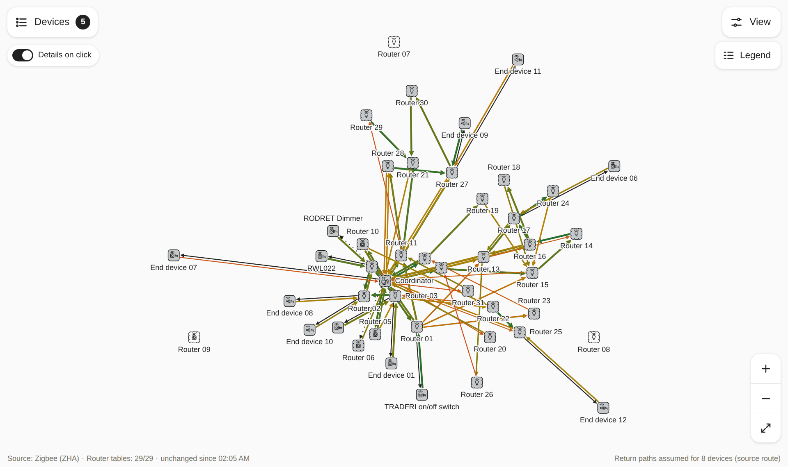
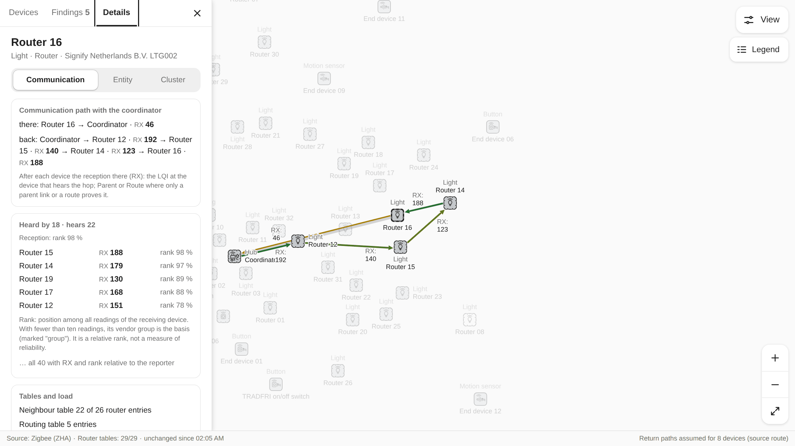
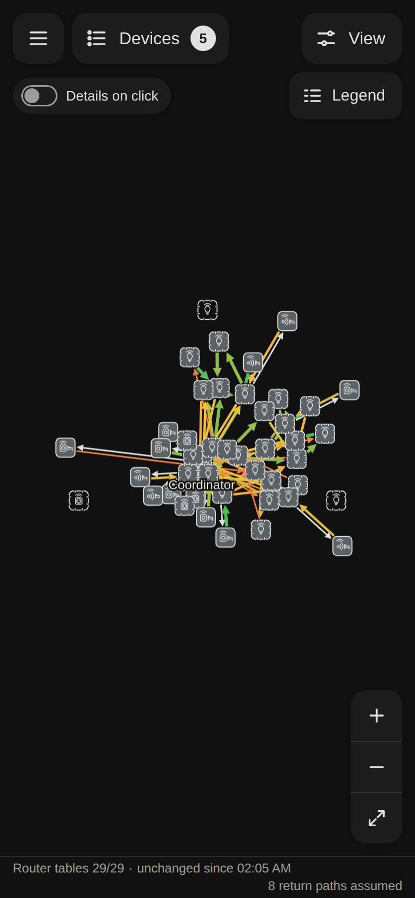
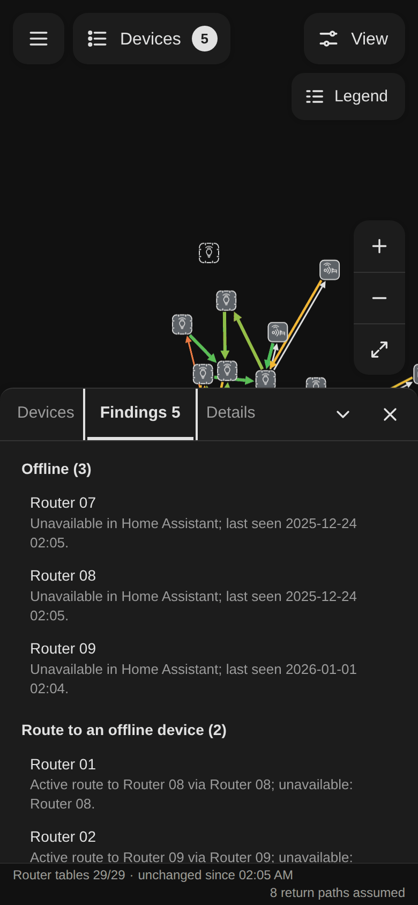
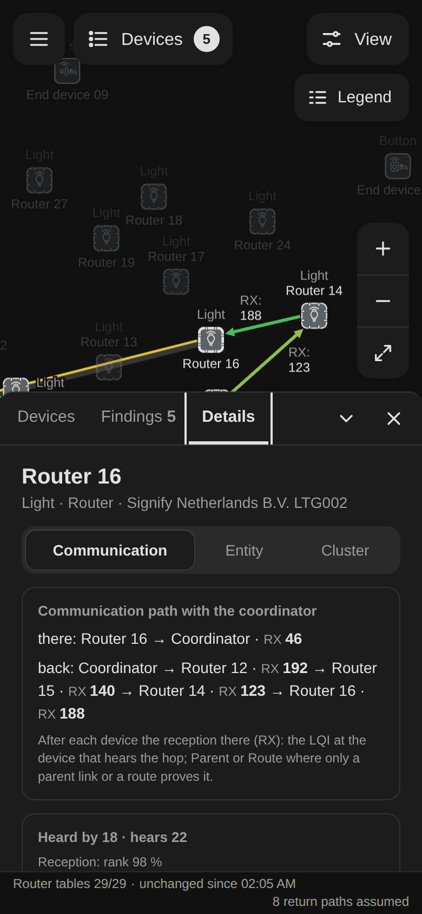

# Meshroute Topology Explorer

A map of the Zigbee and Thread networks in your Home Assistant: which device hears which and how well, the paths the
available data supports, and how complete that data is.

<picture>
  <source media="(prefers-color-scheme: dark)" srcset="docs/images/map-dark.png">
  
</picture>
<sub>The anonymized sample network from this repository: a coordinator, 32 routers, 12 end devices. Links are coloured
by reception, green strong, red weak.</sub>

## Why

You open a network map when something has stopped working: a lamp in the garden drops out, a motion sensor reports
late, a button needs a second press. The map should help you find the cause and should not invent one.

Zigbee routers report their neighbours and routes in tables, and Home Assistant reads those tables at different times,
some of them never. Meshroute is built so that missing data stays visible as missing:

- **Data status first.** The status line says how many router tables were read and when. A device without data is
  grey and marked unknown, never weak.
- **Both directions.** Select a device to see its path to the coordinator and the path back, hop by hop, as far as the
  tables support them, with the reception at each hop.
- **Reception relative to the receiver.** Radios report LQI on different scales. Each reading is ranked among
  everything the receiving device reports, so a low rank means low for that device.
- **Findings with evidence.** Offline devices, routes into an offline device, end devices without a known parent:
  each finding names the table entries it rests on and the tables that are missing.
- **Mouse, touch and keyboard**, a phone layout, light and dark theme.

Home Assistant has its own ZHA and Matter network maps. Meshroute adds the data status, paths in both directions and
findings with their evidence.

## A closer look



In the routing tables of the sample, Router 16 reaches the coordinator directly, while the path back runs over three
other lamps. Selecting a device fades the rest of the network. The Details panel lists every hop with the reception
(RX) at the receiving device and ranks what the device hears from its neighbours.

<p>
  
  
  
</p>

On a phone the panels open from the bottom: the overview, the findings, the details of one device.

## What it does not do

- **It changes nothing.** No device control, no writes to the network. The only radio traffic it causes is a
  topology scan you start and confirm, and reading one cluster's values when you press the button for it.
- **Nothing leaves your house.** No telemetry, no requests to outside services; map tiles only from an address you
  configure yourself.
- **Nothing to build.** The JavaScript in this repository is exactly what Home Assistant serves to your browser.

## Status

| Source | State |
|---|---|
| Zigbee through ZHA | 0.1.1 |
| Thread through the Matter integration | preview |
| Zigbee through Zigbee2MQTT | later |

## Install

Requirements: Home Assistant 2026.9 or newer with ZHA set up. The panel is for administrators.

1. In HACS open the three-dot menu, then Custom repositories.
2. Add `https://github.com/fabcoded/meshroute-topology-explorer` with type Integration.
3. Find Meshroute Topology Explorer in HACS and download it.
4. Restart Home Assistant.
5. Go to Settings > Devices & services > Add integration and add Meshroute Topology Explorer. A "Meshroute" entry
   appears in the sidebar.

Known limits:

- Thread through the Matter integration is a preview.
- The panel is English only.
- Route records come from an internal zigpy interface. After a Home Assistant update the panel may report "not
  supported" for them until the project is adapted.
- Zigbee2MQTT is not supported yet.

Update: download the new version in HACS, restart Home Assistant and reload the browser page.
Removal: delete the integration under Settings > Devices & services, then remove it in HACS and restart.

## Contributing

Bug reports with a capture of the network are the easiest to reproduce: what to include is in
[CONTRIBUTING.md](CONTRIBUTING.md#bug-reports), the capture tool below. Contributions from people and AI agents are
welcome: [AGENTS.md](AGENTS.md), [CONTRIBUTING.md](CONTRIBUTING.md). Behaviour: [docs/spec.md](docs/spec.md).
Security issues: [SECURITY.md](SECURITY.md).

### Capturing your network for a bug report

`tools/capture.py` reads what the panel reads (areas, devices, config entries, ZHA devices with their neighbour and
route tables) and writes an anonymized file to attach to an issue. Python 3.10 or newer, no installation.

1. In Home Assistant, create a long-lived access token in your profile (an administrator account is needed for the
   ZHA command).
2. Run the tool. The token comes from the environment or a prompt without echo; there is no `--token` option,
   because a command line stays in the shell history.

```sh
read -rs HASS_TOKEN && export HASS_TOKEN      # type or paste the token, nothing is shown
python3 tools/capture.py --url http://homeassistant.local:8123 --out capture.json
unset HASS_TOKEN
```

- It sends exactly four read commands (`config/area_registry/list`, `config/device_registry/list`,
  `config_entries/get`, `zha/devices`), no scan, and talks only to the given address. `https://` uses the system's
  certificate store; `--cafile ca.pem` adds your own CA. Certificate checks cannot be switched off.
- Addresses, names, areas and ids are replaced before the file is written (`tools/anonymize_capture.py`). Look
  through the file before you share it. Never paste a token into an issue.
- `--raw` writes real addresses and names. Do not share that file; run
  `python3 tools/anonymize_capture.py raw.json safe.json` on it first.
- Exit codes: 0 ok, 1 usage, 2 cannot connect, 3 authentication failed, 4 command refused, 5 timeout, 6 anonymizer
  refused.

### How the code is organized

The panel lives in `custom_components/meshroute_topology_explorer/frontend/`, plain JavaScript. One viewer engine per
network type, one adapter per data source, and a shared shell that knows neither (spec 4.6):

| Folder | What it holds |
|---|---|
| `engines/index.js` | The registry: `engineFor(network)` finds a network's engine and never falls back to one. |
| `engines/zigbee/` | Zigbee semantics: ZHA schema mapping (`from-zha.js`, with ZHA's capability set), model, paths and theoretical paths, findings, lane classes and the three path views (`lanes.js`, `scene.js`), options, settings keys, status line, texts, Details (`ui/`). |
| `engines/thread/` | Thread read through Matter: Matter mapping (`from-matter.js`), parents, pairs, status and findings (`model.js`), parent and neighbour lanes (`lanes.js`, `scene.js`), status, Details, texts; `quality.js` (reception model, under review, not wired). |
| `adapters/` | Data sources: `zha.js` (scan, observations, fingerprints) and `matter.js`, each with its texts; `index.js` lists them for the shell. |
| `graph/` | Shared drawing: layout (springs from the engine's quality), camera, gestures, symbols, palette, labels, lane geometry and stroke looks, the renderer of the engine's scene. |
| `ui/` | Shared frames: controller, settings client (shell keys), network switch, drawers, Devices, Findings, Legend and View tabs, status line frame, shared texts (`i18n.js`). |
| `panel.js` | The custom element that wires shell, engines and adapters together. |

`tests/engine-leaks.test.mjs` keeps the boundaries: no engine imports another, and shared code reaches the engines
only through `engines/index.js` and names no network or source.

## License and trademarks

[MIT](LICENSE). Zigbee and Matter are trademarks of the Connectivity Standards Alliance, Thread is a trademark of the
Thread Group. This project is not affiliated with or endorsed by them, the Home Assistant project or the Open Home
Foundation.
