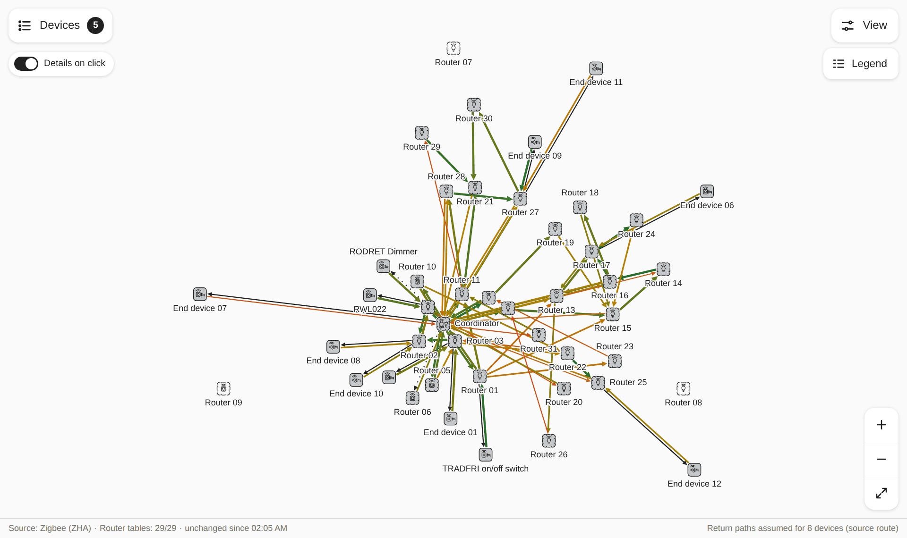
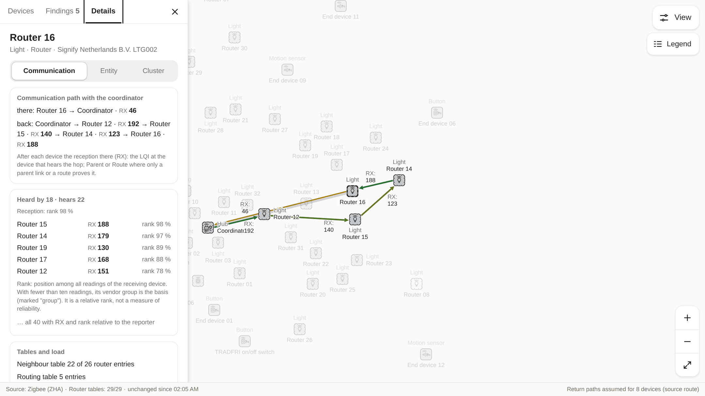
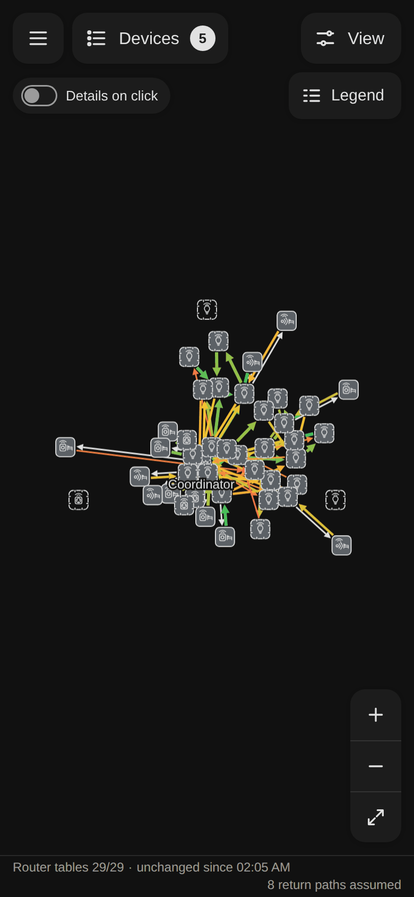
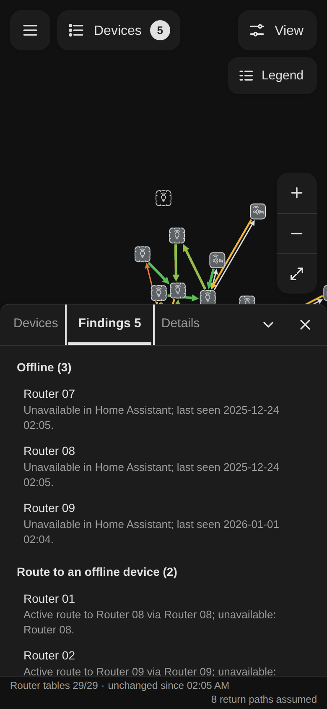
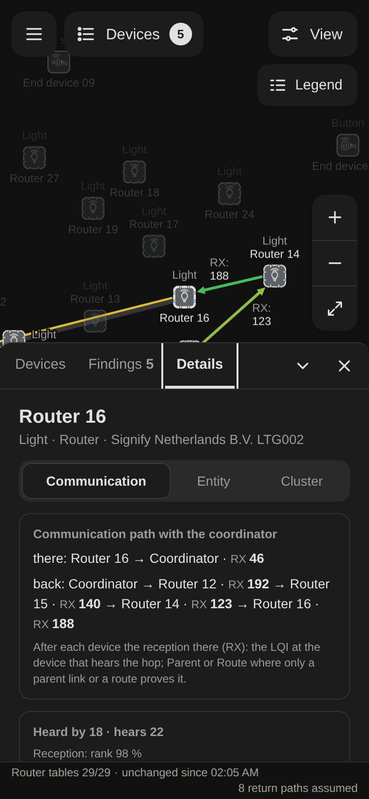
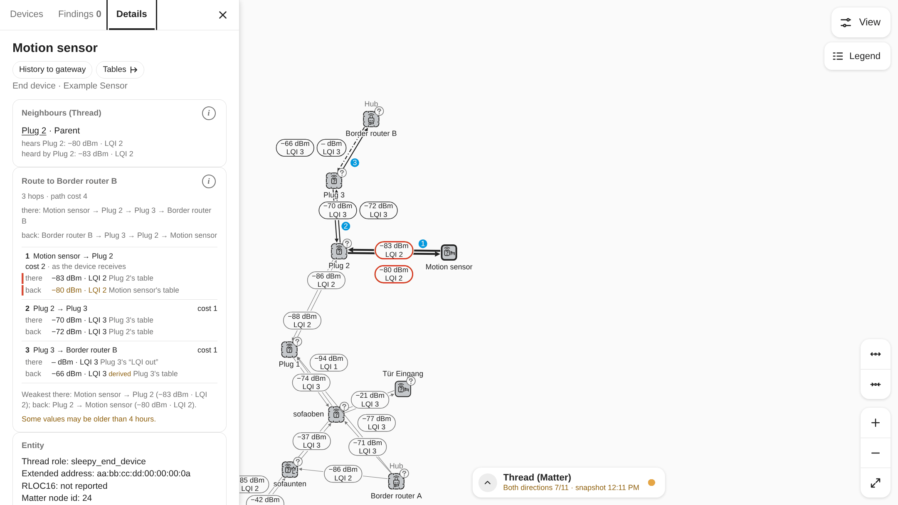
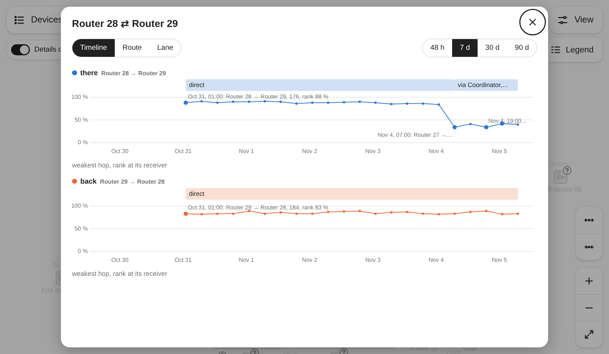
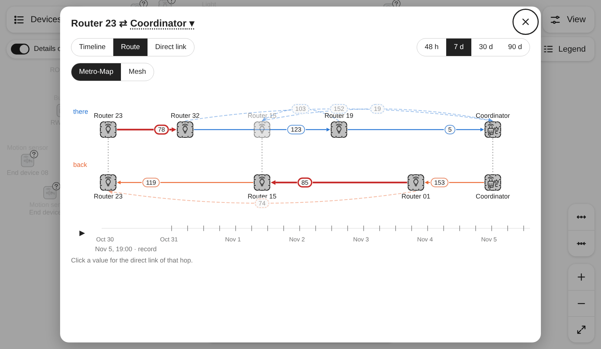
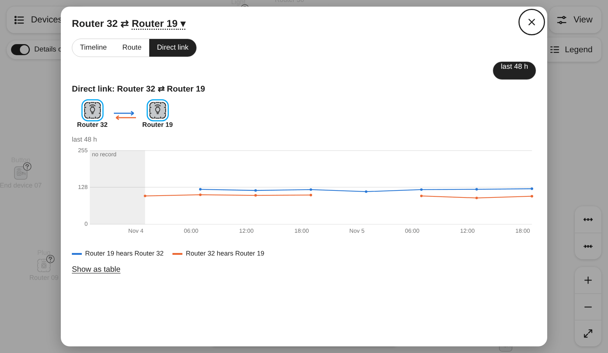

# Meshroute Topology Explorer

A map of the Zigbee and Thread networks in your Home Assistant: which device hears which and how well, the paths the
available data supports, and how complete that data is. Read only: it changes nothing in your network.

**[Try the live demo](https://fabcoded.github.io/meshroute-topology-explorer/)** runs the real panel in your browser on
an invented house with 25 Zigbee and 25 Thread devices and a few typical weak spots. No Home Assistant needed.

<picture>
  <source media="(prefers-color-scheme: dark)" srcset="docs/images/map-dark.png">
  
</picture>
The anonymized sample network from this repository: a coordinator, 32 routers, 12 end devices. Links are coloured
by reception, green strong, red weak.

## Why

You open a network map when something has stopped working: a lamp in the garden drops out, a motion sensor reports
late, a button needs a second press. The map should help you find the cause and should not invent one. Zigbee routers
report their neighbours and routes in tables, and Home Assistant reads those tables at different times, some of them
never. Meshroute is built so that missing data stays visible as missing.

Home Assistant has its own ZHA and Matter network maps. Meshroute adds:

- **Data status:** how many tables were read and when; a device without data is grey and unknown, never weak.
- **Paths in both directions:** to the coordinator and back, hop by hop, with the reception at each hop.
- **Findings with evidence:** offline devices, routes into them, end devices without a known parent, each naming the
  table entries it rests on.
- **History:** how each link's reception changed over days.
- **Reception relative to the receiver:** radios report LQI on different scales; each reading is ranked among
  everything the receiving device reports, so a low rank means low for that device.
- **Mouse, touch and keyboard**, a phone layout, light and dark theme.

## Requirements

- Home Assistant 2026.10 or newer.
- For Zigbee: the ZHA integration. Zigbee2MQTT is not supported yet ([#8](https://github.com/fabcoded/meshroute-topology-explorer/issues/8)).
- For Thread: the Matter integration. Home Assistant's Thread integration is optional; with it, every border router is
  shown by its own name.
- Either network alone is enough. The panel is for administrators ([#7](https://github.com/fabcoded/meshroute-topology-explorer/issues/7)).

## Install

1. In HACS open the three-dot menu, then Custom repositories.
2. Add `https://github.com/fabcoded/meshroute-topology-explorer` with type Integration.
3. Find Meshroute Topology Explorer in HACS and download it.
4. Restart Home Assistant.
5. Go to Settings > Devices & services > Add integration and add Meshroute Topology Explorer. A "Meshroute" entry
   appears in the sidebar.

Update: download the new version in HACS, restart Home Assistant and reload the browser page. Removal: delete the
integration under Settings > Devices & services, then remove it in HACS and restart.

Questions, observations and bug reports go to [GitHub issues](https://github.com/fabcoded/meshroute-topology-explorer/issues/new/choose).
This is a hobby project and is still being tried out by a few people; feedback on whether the map matches your network
is the most useful thing you can send.

## Status and limits

| Source | State |
|---|---|
| Zigbee through ZHA | released: map, paths, findings, reception history |
| Thread through the Matter integration | preview: map, neighbours, routes, border routers; routes are not recorded in the history yet ([#11](https://github.com/fabcoded/meshroute-topology-explorer/issues/11)) |
| Zigbee through Zigbee2MQTT | later |

- The panel is English only.
- Zigbee route records come from an internal zigpy interface. After a Home Assistant update the panel may report "not
  supported" for them until the project is adapted.
- Thread tables come from the Matter server's cache and can be many hours old; the panel shows when they were read.

## Settings

Settings > Devices & services > Meshroute > Configure (administrators): show in the sidebar; record reception values
(Zigbee after each of ZHA's own topology scans, Thread every 4 hours; keep 1 to 90 days, default 30), from what ZHA and
the Matter server already hold, never starting a scan; delete the recorded history. With ZHA set up, a Zigbee section:
allow scan and attribute reads in the panel (off hides both; ZHA's own pages still offer them), optionally one ZHA scan
30 minutes after each start (off by default), and ZHA's scan period with a note how to change it (the integration
never edits configuration.yaml). Details: [spec](docs/spec.md#101-options-v1).

## A closer look

In the routing tables of the sample, Router 16 reaches the coordinator directly, while the path back runs over three
other lamps. Selecting a device fades the rest of the network. The Details panel lists every hop with the reception
(RX) at the receiving device and ranks what the device hears from its neighbours.

  
  
  

On a phone the panels open from the bottom: the overview, the findings, the details of one device.

## Thread

<picture>
  <source media="(prefers-color-scheme: dark)" srcset="docs/images/thread-route-dark.png">
  
</picture>

Selecting a Thread device draws its route to the border router, there and back, as Thread forwards it, from the route
and neighbour tables the Matter server holds. Details list each hop with both directions, the path cost and when each
table was read. No Thread radio traffic is caused.

## History: what changed, and when

The tables only show the moment of the last scan: a link that was weak at night can look fine in the morning. After each of ZHA's own topology scans
the integration therefore keeps a record of every link's reception, the routing tables and the end devices' parents:

- **Own small files, nothing else.** Kept for 1 to 90 days (default 30; about 2.4 MB for 30 days on a network of 47
  devices), never in Home Assistant's recorder. Recording never starts a scan; the optional single scan 30 minutes after
  a start is off by default.
- **One pair at a time, one click away.** Click a reception value on the map (a small card shows both directions of that direct link and leads on to the window), press **History to gateway** in a device's Details,
  or select a device and click the small "?" badge at another one. The window opens for the two devices (its second
  name is a menu to change the partner), with three views:
  - **Timeline:** the route in each direction as spans over time, and below it the rank of the weakest hop at its
    receiver.
  - **Route:** the hops as a Metro-Map or in place on the map (Mesh), with a time slider. Earlier routes stay as faded
    ghosts.
  - **Direct link:** both directions of one link between two neighbours over time. A click on a reception pill in
    the Route view opens it.
- **48 h sparklines** in Details show how each neighbour's reception moved.
- **Thread in the window:** Thread routes are shown on the map and in Details, but not recorded in the history yet
  [later, #11]: the window shows the direct link and its neighbours per record.

<picture>
  <source media="(prefers-color-scheme: dark)" srcset="docs/images/history-route-dark.png">
  
</picture>

The same pair in the Route view: the current routes there and back, earlier ones as ghosts. The history is a
synthetic series made from the sample network (`tools/history_synth.mjs`).

## What it does not do

- **It changes nothing.** No device control, no writes to the network. The only radio traffic it causes is a
  topology scan you start and confirm, and reading one cluster's values when you press the button for it.
- **Nothing leaves your house.** No telemetry, no requests to outside services; map tiles only from an address you
  configure yourself.
- **Nothing to build at install.** Your browser loads one readable file, `frontend/dist/panel.js`, generated from the JavaScript
  beside it with its comments and committed with it; a check proves the two match.

## Contributing

Bug reports with a capture of the network are the easiest to reproduce: what to include is in
[CONTRIBUTING.md](CONTRIBUTING.md#bug-reports), how to capture it in [docs/development.md](docs/development.md).
Contributions from people and AI agents are welcome: [AGENTS.md](AGENTS.md), [CONTRIBUTING.md](CONTRIBUTING.md).
Behaviour: [docs/spec.md](docs/spec.md). Tests and quality measures: [docs/quality.md](docs/quality.md). How the code
is organized: [docs/development.md](docs/development.md#how-the-code-is-organized). Security issues:
[SECURITY.md](SECURITY.md).

## License and trademarks

[MIT](LICENSE). Zigbee and Matter are trademarks of the Connectivity Standards Alliance, Thread is a trademark of the
Thread Group. This project is not affiliated with or endorsed by them, the Home Assistant project or the Open Home
Foundation.
